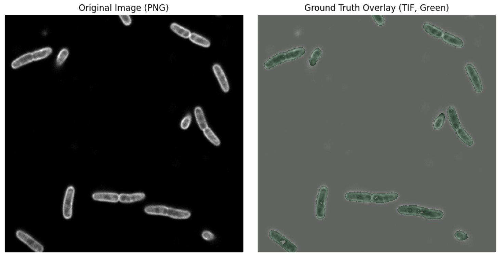
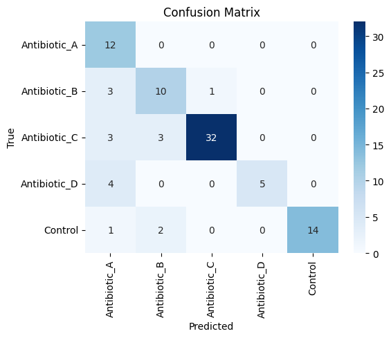

# Antibiotic_Phenotyping

##  Part 1: Segmentation Accuracy Evaluation of Cellpose on Antibiotic-Treated Images

In the first stage of this project, I systematically evaluated the performance of the Cellpose segmentation model on phase-contrast microscopy images of bacterial cells subjected to different antibiotics. Ground truth masks were manually annotated using FIJI, while model-generated masks were obtained via Cellpose. To quantify performance, I computed key pixel-level segmentation metrics—F1 score (Dice coefficient), Intersection over Union (IoU), precision, recall, and accuracy—across a curated set of 20 images. Additionally, I removed small artifacts to reduce false positives and produced per-image overlays visualising true positives (green), false positives (red), and false negatives (blue). A cumulative confusion matrix was generated to summarise performance across all images. Mean F1 and IoU scores exceeded 0.90 and 0.83, respectively, with recall consistently high, indicating the model captured nearly all true cell regions.

This pipeline ensures reproducible, quantitative, and visual validation of Cellpose in biologically relevant conditions and lays the groundwork for the next phases of this study.

  

Segmentation Mask Validation: Pixel-wise Metrics

To verify the quality of Cellpose-generated segmentation masks, we performed pixel-level comparison against manually annotated ground truth. Metrics such as F1 Score, IoU, Precision, Recall, and Accuracy were computed for each image.

  
<em>Per-image segmentation metrics (F1, IoU, Precision, etc.)</em>
 

The results demonstrate high agreement between predicted and ground truth masks, with:

Mean F1 Score ≈ 0.91

Mean IoU ≈ 0.83

Mean Recall ≈ 0.97

In addition, the overall confusion matrix shows strong accuracy across all pixels:

  
<em>Normalized confusion matrix across all images</em>
 

✔These results confirm that the predicted masks are sufficiently accurate and can be reliably used for further morphological or phenotypic analysis.

#  Part 2 — Single-Cell Extraction & Classification
Segmented single-cell patches (membrane + DNA) were used to train a ResNet-18 model to classify antibiotic treatments based on morphology and fluorescence patterns.

Output:
Objective:
Extract single bacterial cells from microscopy images using segmentation masks, then classify them based on morphological features visible in membrane (red) and DNA (blue) channels.

## Process:
1.Used validated masks to extract individual cells
2.Resized cells to 64×64 patches
3.Labeled each patch by antibiotic condition
4.Trained a lightweight CNN classifier to predict the antibiotic class based on visual features

## Dataset Summary:
Class	Cell Count

Control	75

Antibiotic_A	78

Antibiotic_B	82

Antibiotic_C	174

Antibiotic_D	38

Total	447

## Classifier Used:
Model: CNN with 2 convolutional layers + dense layers
Input: RGB patches (64×64)
Output: Antibiotic class (5-way classification)
Split: 80% train / 20% test (random across all classes)

## Classification Results:

  

Training Accuracy: ~99%
Test Accuracy: High accuracy observed for dominant classes
Morphological traits helped the model learn drug-induced differences

# Part 3: Morphological Feature Analysis by Antibiotic Class

To quantify and compare DNA and membrane morphology across antibiotics using image-derived features from single-cell segmentation. This analysis aims to understand how different antibiotics affect bacterial structure.

 What We Did
Step	Description
1. Channel Isolation	Extracted the DNA (blue) and membrane (red) channels from each cell patch.
2. Feature Extraction	Computed key morphological features:
– Mean intensity	
– Signal area	
– Circularity	
– DNA-to-membrane intensity ratio	
– Optional texture metrics (entropy, variance)	
3. Control Comparison	Compared each antibiotic’s feature distribution with the control group to detect structural shifts.
4. Visualization	Presented per-cell visual summaries with metrics overlay, enabling qualitative assessment across classes.

 Outcome
This stage provides:

Insight into how each antibiotic alters DNA or membrane morphology

| #  | Model Name                   | Architecture Type           | Highlights & Purpose                                            |
| -- | ---------------------------- | --------------------------- | --------------------------------------------------------------- |
| 1  | **ResNet-18**                | CNN (Residual Network)      | Baseline classifier with skip connections                       |
| 2  | **VGG-16**                   | CNN (Deep Sequential)       | Classic deep CNN for comparison                                 |
| 3  | **DenseNet-121**             | CNN (Densely Connected)     | Encourages feature reuse across layers                          |
| 4  | **MobileNet V2**             | Lightweight CNN             | Designed for efficient, mobile-friendly models                  |
| 5  | **Inception V3**             | Multi-path CNN              | Uses varied kernel sizes for multi-scale feature extraction     |
| 6  | **ViT (Vision Transformer)** | Transformer-based Vision    | Global context via patch-based attention                        |
| 7  | **ConvNeXt-Tiny**            | Modern CNN                  | Combines ConvNets with Transformer design cues                  |
| 8  | **Swin Transformer**         | Hierarchical Transformer    | Local to global attention using shifting windows                |
| 9  | **MaxViT**                   | Hybrid CNN + Transformer    | Combines convolution and attention for rich representation      |
| 10 | **RegNetY-400MF**            | Efficient CNN               | Optimized scalable model with good accuracy-efficiency tradeoff |
| 11 | **CoAtNet**                  | CNN + Transformer Hybrid    | Balances inductive bias and generalization                      |
| 12 | **BEiT v2**                  | Self-supervised Transformer | Learns strong features via masked image modeling                |

A quantitative summary of per-channel cell behavior

Foundational features for downstream classification (Part 4)

