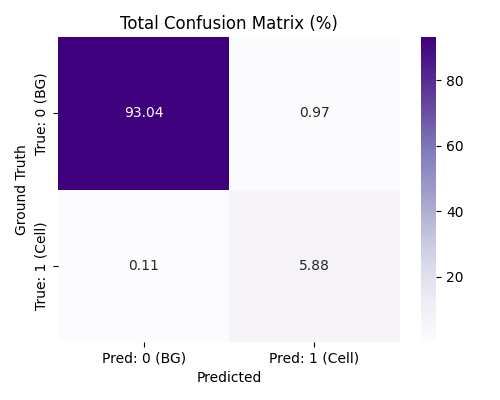

# Antibiotic_Phenotyping

## 🧪 Part 1: Segmentation Accuracy Evaluation of Cellpose on Antibiotic-Treated Images

In the first stage of this project, I systematically evaluated the performance of the Cellpose segmentation model on phase-contrast microscopy images of bacterial cells subjected to different antibiotics. Ground truth masks were manually annotated using FIJI, while model-generated masks were obtained via Cellpose. To quantify performance, I computed key pixel-level segmentation metrics—F1 score (Dice coefficient), Intersection over Union (IoU), precision, recall, and accuracy—across a curated set of 20 images. Additionally, I removed small artifacts to reduce false positives and produced per-image overlays visualising true positives (green), false positives (red), and false negatives (blue). A cumulative confusion matrix was generated to summarise performance across all images. Mean F1 and IoU scores exceeded 0.90 and 0.83, respectively, with recall consistently high, indicating the model captured nearly all true cell regions.

This pipeline ensures reproducible, quantitative, and visual validation of Cellpose in biologically relevant conditions and lays the groundwork for the next phases of this study.

  

✅ Segmentation Mask Validation : Pixel-wise Metrics

To verify the quality of Cellpose-generated segmentation masks, we performed pixel-level comparison against manually annotated ground truth. Metrics such as F1 Score, IoU, Precision, Recall, and Accuracy were computed for each image.

  
<em>Per-image segmentation metrics (F1, IoU, Precision, etc.)</em>
 

The results demonstrate high agreement between predicted and ground truth masks, with:

Mean F1 Score ≈ 0.91

Mean IoU ≈ 0.83

Mean Recall ≈ 0.97

In addition, the overall confusion matrix shows strong accuracy across all pixels:

  
<em>Normalized confusion matrix across all images</em>
 

✔️ These results confirm that the predicted masks are sufficiently accurate and can be reliably used for further morphological or phenotypic analysis.
